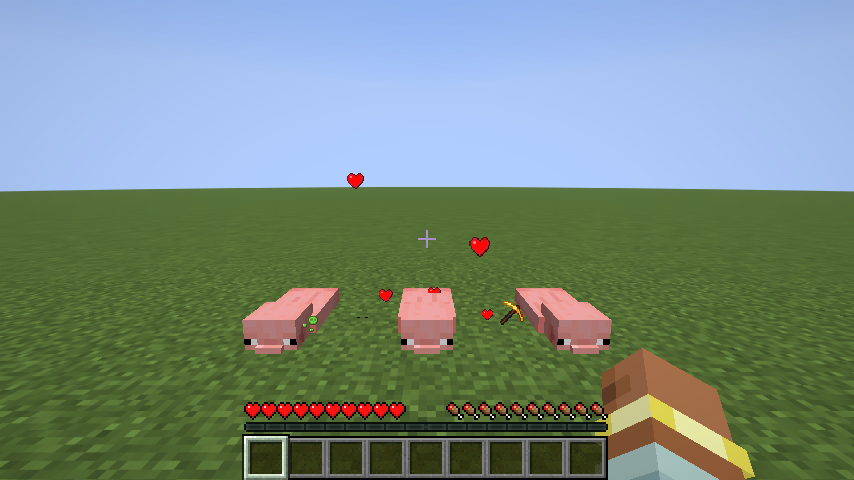

# Quantum Particle Effect

포션 효과마다 다른 파티클 텍스처를 쓰게 해 주는 Fabric 모드예요. (Minecraft 26.3, 클라이언트 전용)



왼쪽부터 독, 재생, 성급함이에요. 파티클로 인벤토리 효과 아이콘이 나와요.

## 설치

- Fabric Loader 0.20.1 이상, Java 25
- `build/libs/quantumparticleeffect-<버전>.jar` 파일을 `mods` 폴더에 넣으면 돼요.
- 클라이언트에만 설치하면 돼요. 서버에는 설치하지 않아도 되고, 일반 서버에서도 동작해요.

## 어떤 텍스처가 나오나요

효과 `<네임스페이스>:<이름>`마다 아래 순서로 찾아요.

1. **리소스팩 전용 텍스처**: `assets/<네임스페이스>/particles/effect/<이름>.json`이 있으면 그 텍스처를 써요. 기본 파티클처럼 포션 색을 덧입혀요.
2. **인벤토리 효과 아이콘**: `textures/mob_effect/<이름>.png`를 그린 색 그대로 써요. 다른 모드의 효과도 아이콘만 있으면 자동으로 돼요. 리소스팩으로 아이콘을 바꾸면 파티클도 같이 바뀌어요.
3. 둘 다 없으면 기본 파티클이 나와요.

## 리소스팩으로 파티클만 따로 바꾸기

아이콘 말고 파티클만 다른 그림을 쓰고 싶으면 리소스팩에 두 파일을 넣으면 돼요. 예: 성급함(`minecraft:haste`)

`assets/minecraft/particles/effect/haste.json`
```json
{
  "textures": ["mypack:effect/haste"]
}
```

`assets/mypack/textures/particle/effect/haste.png` (8×8 권장, **흰색/회색으로** 그리기)

- 이 텍스처에는 포션 색이 곱해져서 입혀져요. 그래서 흰색/회색 명암으로 그려야 하고, 밝은 부분일수록 포션 색이 선명하게 나와요.
- 텍스처를 여러 장 넣으면 파티클이 사라지는 동안 순서대로 바뀌어요. 기본 `entity_effect.json`과 같은 방식이에요.

## 알아 둘 점

- 서버는 효과 종류 대신 **효과 색만** 보내 줘요. 그래서 모드는 색으로 효과를 찾아요.
  - 색이 같은 효과(예: 즉시 회복과 포화)는 먼저 등록된 효과의 텍스처를 써요.
  - 효과가 여러 개 섞인 물약 구름이나 화살은 색이 섞여서 기본 파티클로 나와요.
- 시련의 징조, 습격의 징조는 원래부터 전용 파티클이 있어서 바뀌지 않아요.

## Maven

GitHub에서 릴리스를 만들면 GitHub Actions가 GitHub Packages(Maven)에 자동으로 올려요. 릴리스 전에 `gradle.properties`의 `version`을 올려 주세요.

다른 모드에서 쓰려면:

```groovy
repositories {
	maven {
		url = "https://maven.pkg.github.com/qmftm/QuantumParticleEffect"
		credentials {
			username = System.getenv("GITHUB_ACTOR")
			password = System.getenv("GITHUB_TOKEN") // read:packages 권한이 있는 토큰
		}
	}
}

dependencies {
	modImplementation "com.qmftm:quantumparticleeffect:1.0.0"
}
```

GitHub Packages는 공개 패키지도 받을 때 GitHub 토큰이 필요해요.

## 빌드 / 테스트

```
./gradlew build              # build/libs 에 jar 생성
./gradlew runClient          # 개발용 클라이언트 실행
./gradlew runClientGameTest  # 월드를 만들어 효과를 주고 스크린샷 저장
./gradlew publishToMavenLocal # ~/.m2 에 배포해서 확인
```
